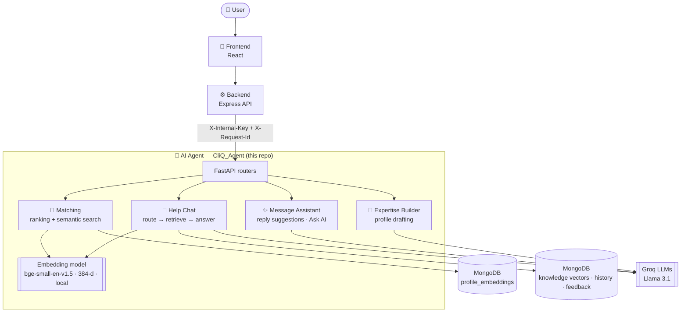

<div align="center">

# 🤖 CliQ — AI Agent

### The brain behind CliQ

*Matchmaking, semantic search, a grounded help chatbot and an in-chat reply assistant*

<br/>


<br/>

**`Embed`** ➜ **`Retrieve`** ➜ **`Rank`** ➜ **`Generate`** ➜ **`Learn`**

<br/>

[🌐 Live Demo](https://cliq-web-rho.vercel.app/) &nbsp;•&nbsp;
[🎨 Frontend](https://github.com/Aman-kumar-git12/CliQ_Web) &nbsp;•&nbsp;
[⚙️ Backend](https://github.com/Aman-kumar-git12/CliQ_Backend) &nbsp;•&nbsp;
[🤖 AI Agent](https://github.com/Aman-kumar-git12/CliQ_Agent)

</div>

---

**CliQ** is a social + professional networking platform: build a profile around your **expertise**, share
posts, discover the **right people**, and collaborate over **real-time chat**.

> [!NOTE]
> This repository is the **AI service** behind CliQ, built with FastAPI. It powers **four AI features**:
> smart connections, semantic people search, the CliQ AI help chatbot and the in-chat reply assistant, plus
> the AI expertise builder. Only the Node backend calls it, with a shared secret; the browser never does.

## 📦 Repositories

CliQ is split into three services:

| Service | Tech | Repository |
|---|---|---|
| 🎨 **Frontend** | React · Vite · Tailwind | [Aman-kumar-git12/CliQ_Web](https://github.com/Aman-kumar-git12/CliQ_Web) |
| ⚙️ **Backend** | Node · Express · Prisma · MongoDB · Redis | [Aman-kumar-git12/CliQ_Backend](https://github.com/Aman-kumar-git12/CliQ_Backend) |
| 🤖 **AI Agent** (this repo) | Python · FastAPI · Groq · Embeddings | [Aman-kumar-git12/CliQ_Agent](https://github.com/Aman-kumar-git12/CliQ_Agent) |

---

## 🧩 The Problem

Communication is easy today, but meaningful collaboration is still hard:

1. Finding the **right** people means scrolling through profiles and guessing.
2. Keyword search misses people: "ML engineer" doesn't find someone who wrote "deep learning".
3. Writing a strong profile is hard, so most profiles stay empty.
4. Starting or replying to a conversation with a new connection is awkward.
5. Generic chatbots make up answers about features that don't exist.

## 💡 The Solution

CliQ uses AI where it helps most, and keeps it **fast, grounded and safe**:

- **Understands people, not keywords:** profiles become vector embeddings, so matching and search work by meaning.
- **Learns from you:** people you mark interested, save or ignore change your future recommendations.
- **Writes with you:** drafts your expertise section and suggests chat replies in the tone you choose.
- **Answers only from facts:** the help bot uses RAG over CliQ's own docs and admits when it doesn't know.

---

## 🏗️ Architecture



Embeddings run **locally** (FastEmbed, no API cost). Only text generation goes to Groq, which is chosen for
its very low latency.

---

## 🧠 The AI Features in Depth

### 🎯 1. Smart Connections (matchmaking)

Ranks who you should meet in two stages: **retrieve**, then **re-rank**.

1. **Embed:** each profile (skills, interests, expertise, bio) becomes a 384-dimensional vector with
   `bge-small-en-v1.5`.
2. **Retrieve:** the top ~180 candidates by a blended score: vector similarity (72%), plus skill, interest and
   keyword overlap.
3. **Re-rank:** the top 60 by vector similarity, skills, interests, profile quality and your explicit preferences.
4. **Learn from history:** your vector score blends your **base** profile (64%) with people you liked
   (+28%) and people you ignored (−22%), so recommendations shift as you use the app.
5. **Explain:** each result comes with a reason (shared skills, similar interests), which is shown in the UI.

**Built for speed and cost:**

- Embeddings are saved in MongoDB (`profile_embeddings`, packed float32, ~1.5 KB per user) and loaded at
  startup, so a restart or a Render wake-up re-embeds **nobody**. A profile is embedded again only when its
  content hash changes.
- Up to 3,000 recently used profiles stay in an in-memory LRU cache.
- CPU-heavy work runs in worker threads (`asyncio.to_thread`), so health checks stay responsive.
- If the embedding model can't load, a **hash embedding** fallback keeps matching working.

### 🔎 2. Semantic People Search

Searches by **meaning**: "someone good at ML" finds people who wrote "deep learning" or "PyTorch". The query
is embedded and compared with every profile vector, and a minimum similarity score filters out weak matches.

### 💬 3. CliQ AI Help Chatbot (RAG)

Answers "how do I…" questions about CliQ, grounded **only** in CliQ's own documentation.

1. **Route:** one fast LLM call splits the message into up to 3 parts and labels each one (steps,
   information, navigation, greeting, general help or out of scope). Simple greetings skip this call entirely.
2. **Retrieve:** each part is embedded and matched against the knowledge base, 14 topic files where every
   `##` section is one searchable chunk.
3. **Answer:** the LLM writes the answer from those chunks only, taking into account the page the user is on.
4. **Stream:** status updates, tokens and follow-up suggestions are sent as **Server-Sent Events**.
5. **Learn from 👍/👎:** feedback is stored. Highly rated answers to near-identical questions (≥ 0.92
   similarity, 2+ approvals) are reused, and chunks voted down move lower in retrieval. No retraining and
   no extra LLM calls.

It also keeps chat history, answers in the user's language and shows a clear message on rate limits.

### ✨ 4. Message Assistant (in-chat AI)

Helps users reply inside a 1:1 chat.

- **Reply suggestions** based on the recent conversation.
- **Ask AI** about the chat ("summarize this", "what should I say next?").
- **10 tones:** casual, polite, formal, flirty, professional, witty, direct, friendly, empathetic and
  confident, with optional emoji.
- **Safety first:** a keyword screen and an LLM classifier block coercive or abusive requests (blackmail,
  stalking, manipulation…). They run **in parallel** with routing, so safety adds no delay.
- **Fallback chain:** if a model fails, the next one is tried; if all fail, rule-based classifiers and canned
  responses keep it working.

### 🧠 5. Expertise Builder ("Magic Builder")

Turns a user's answers into a structured expertise profile (skills, projects, achievements, interests).

- **Fact protection:** numbers, companies and certifications are extracted first and must appear in the
  output **exactly**, so the LLM can't change "3 years" into "5 years".
- **Skill normalization:** "reactjs" and "React.js" both become **React**, and duplicates are removed.
- **Refine mode:** improves an existing profile instead of starting over.
- **Never fails silently:** if the LLM fails, a deterministic draft is built from the answers.

---

## 🛠️ Problems Solved with AI

| Problem | How the agent solves it | Tech |
|---|---|---|
| Finding the right people | Two-stage retrieve → re-rank with feedback learning | bge-small embeddings, cosine similarity, weighted scoring |
| Keyword search misses people | Search by meaning | Vector search |
| Chatbots invent answers | Answers only from CliQ's own docs | RAG (LangChain + MongoDB vectors) |
| Bots don't improve | 👍/👎 change future answers and retrieval order | Feedback memory, similarity reuse |
| Awkward conversations | Reply suggestions in 10 tones | Groq Llama 3.1 + prompt templates |
| Harmful message requests | Blocked before generation | Keyword screen + LLM safety classifier |
| LLMs change facts | Extracted facts must be preserved exactly | Fact extraction + output validation |
| Slow AI responses | Streaming, fast router, 8 s classifier timeout, low reasoning effort | Groq, Server-Sent Events |
| Re-embedding is expensive | Embeddings saved and reused until a profile changes | MongoDB vector store, content hashing |
| AI providers go down | Fallback models, rule-based fallbacks, deterministic drafts | Model chain, graceful degradation |

## ✨ Features

- 🎯 **Smart connections** with explainable reasons and feedback learning
- 🔎 **Semantic people search**
- 💬 **CliQ AI help chatbot**: RAG, streaming, multi-part questions, page-aware, multilingual, learns from 👍/👎
- ✨ **Message assistant**: reply suggestions, Ask AI, 10 tones, safety screening
- 🧠 **Expertise builder**: fact-preserving profile drafts with skill normalization
- 🔐 **Internal-only API**: every endpoint needs `X-Internal-Key`, with zero-downtime key rotation
- 📈 **Observable**: request IDs on every log line, optional Sentry, JSON logs

## 🧰 Tech Stack

| Layer | Technologies |
|---|---|
| **API** | Python 3.12, FastAPI, Uvicorn, Pydantic, pydantic-settings |
| **LLMs** | Groq (Llama 3.1 8B Instant), LangChain (`langchain-groq`) |
| **Embeddings** | FastEmbed, `BAAI/bge-small-en-v1.5` (384-d, runs locally), NumPy |
| **Vector store / data** | MongoDB Atlas (`langchain-mongodb`, PyMongo) |
| **Quality** | pytest, Ruff, live answer-quality eval, GitHub Actions |
| **Ops** | Docker, Render, Sentry |

### Endpoints

| Feature | Folder | Endpoints |
|---|---|---|
| Help chatbot | `src/help_chat/` | `POST /api/chat`, `POST /api/chat/stream`, `POST /api/chat/feedback`, `GET /api/chat/kb-version`, `POST /api/chat/history/append` |
| Reply assistant | `src/message_assistant/` | `POST /api/message-ai/respond`, `POST /api/message-ai/respond/stream` |
| Expertise builder | `src/expertise/` | `POST /api/expertise/generate` |
| Matching and search | `src/matching/` | `POST /api/match/match`, `POST /api/match/precompute`, `POST /api/match/search` |
| Status | `src/system/` | `GET /` (status page), `GET /api/health` |

---

## ⚡ Getting Started

```bash
python3.12 -m venv .venv
.venv/bin/pip install -r requirements-dev.txt
cp .env.example .env                          # then fill in DATABASE_URL and GROQ_API_KEY
.venv/bin/python scripts/download_model.py    # puts the embedding model in .cache/ (once per build)
.venv/bin/python scripts/check_groq.py        # confirms the key works with both models
.venv/bin/python app.py                       # http://localhost:8000, reloads on code changes
```

`.env` is read once at startup, so restart after changing it. To run the whole stack, also clone the
[backend](https://github.com/Aman-kumar-git12/CliQ_Backend) and the
[frontend](https://github.com/Aman-kumar-git12/CliQ_Web); the backend's `docker compose up --build` starts everything.

## 🧪 Tests

```bash
.venv/bin/python -m pytest                       # fast, offline unit tests (no real secrets needed)
.venv/bin/python tests/eval/run_eval.py --pause 10   # live answer-quality check (uses Groq quota)
```

CI (`.github/workflows/ci.yml`) runs `ruff check`, `ruff format --check`, the unit tests and a Docker build on
every push and pull request.

## 📚 Editing the Help Chat Knowledge Base

The chatbot answers only from `src/help_chat/knowledge/data/*.txt`. After editing any of them, re-embed:

```bash
.venv/bin/python -m src.help_chat.knowledge.ingest
```

Every file follows the same template, and each `## ` section becomes one searchable chunk:

```
# Feature: <Name>
Route: <page path>
## Summary
## How to <task>        numbered steps, exact UI labels in **bold**
## Limits
## Common problems      "- Problem: ... → Fix: ..."
```

## 📁 Project Layout

```
src/
├── main.py            creates the app: logging, startup/shutdown, CORS, routers
├── core/              shared infrastructure, never imports from a feature
│   ├── config.py      Settings: the only place that reads environment variables
│   ├── logging.py     log format (text or JSON), with the request id on every line
│   ├── request_id.py  X-Request-Id middleware and the log filter
│   ├── monitoring.py  optional Sentry setup
│   ├── database.py    the one MongoDB client
│   ├── embeddings.py  the local embedding model (bge-small-en-v1.5)
│   ├── llm.py         Groq model factories
│   └── security.py    X-Internal-Key check, required on every feature endpoint
├── help_chat/         router → service → pipeline (routing → retrieval → answering)
│   └── knowledge/     knowledge base files, chunking, vector store, ingest script
├── message_assistant/
├── expertise/
├── matching/          ranking + people search; vector_store.py keeps profile embeddings in MongoDB
└── system/            status page, health check, keep-alive pinger
tests/
├── unit/              fast, offline: pytest
└── eval/              live answer-quality check against Groq: run_eval.py
scripts/               one-off command-line tools (check_groq.py, download_model.py)
```

Every feature folder has the same shape: `router.py` (HTTP only) → `service.py` (logic, no HTTP) →
`schemas.py` (Pydantic models), plus `prompts.py` (every LLM prompt) and `dependencies.py`. Services are built
once at startup and injected with `Depends(...)`, so tests can swap in fakes.

## ⚙️ Reliability and Operations

- **Timeouts:** 20 s for LLM calls, 8 s for classifiers, 5 s for MongoDB. A slow provider becomes a fast, clear error.
- **Smart retries:** only fast failures (5xx, dropped connection) are retried once, and only before the first
  token. Rate limits reach the user immediately with a clear message.
- **Works without the database:** the help chat still answers, just without history or feedback.
- **Request IDs:** every response and log line carries `X-Request-Id`, shared with the backend.
- **Sentry (optional):** set `SENTRY_DSN`. No PII, request bodies or the internal key are sent.
- **Key rotation without downtime:** set the new `AGENT_INTERNAL_KEY` and the old one as
  `AGENT_INTERNAL_KEY_PREVIOUS` on the agent, update the backend, then remove the old key.
- **Render free tier:** the model is downloaded at build time (`scripts/download_model.py`). Set
  `KEEPALIVE_URL` to the agent's public URL to keep it awake.

---

## 🔗 Related Repositories

- 🌐 Live website: https://cliq-web-rho.vercel.app/
- 🎨 Frontend: https://github.com/Aman-kumar-git12/CliQ_Web
- ⚙️ Backend: https://github.com/Aman-kumar-git12/CliQ_Backend
